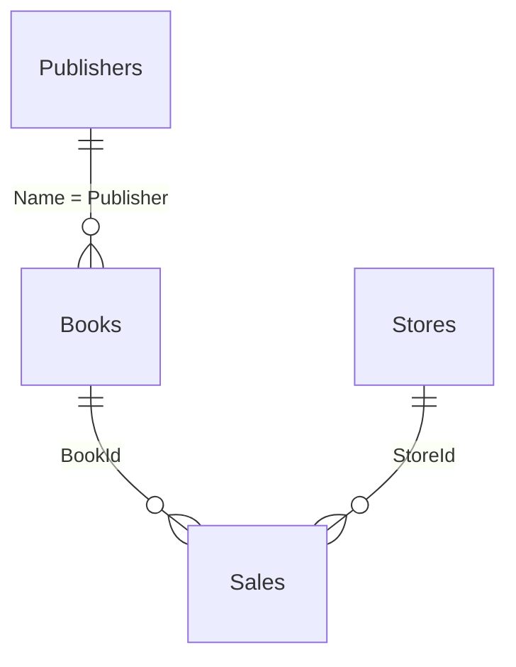

# Kitab mağazası bazası: SQL praktikası və JOIN təhlili

Kitab mağazası şəbəkəsi üçün kiçik baza qurulur və kitablar, naşirlər, mağazalar və satışlar üzərində sorğular yazılır. Layihənin əsas məqsədi bütün JOIN növlərinin nə vaxt hansı nəticəni verdiyini real suallarla göstərməkdir.

## Baza sxemi

Cədvəllər: `Books`, `Publishers`, `Stores`, `Sales`.
Məlumata qəsdən `NULL` dəyərlər, naşiri olmayan kitablar və satılmamış kitablar daxil edilib ki, JOIN fərqləri görünsün.

## Mövzular

| Tapşırıqlar | Mövzu |
|---|---|
| 1-15 | Cədvəl yaratma, `ALTER`, `INSERT`, `SELECT`, `DISTINCT`, `UPDATE`, `DELETE` |
| 16-30 | `LIKE`, `NULL` ilə işləmək (`ISNULL`, `NULLIF`), hesablanan sütunlar |
| 31-50 | `ORDER BY`, mətn/riyazi/tarix funksiyaları, `CASE WHEN` ilə qruplaşdırma |
| 51-74 | Aqreqat funksiyalar, `GROUP BY`, `HAVING`, `NULL`-ların sayılması (3 üsul) |
| 75-80 | `Publishers`, `Stores`, `Sales` cədvəllərinin yaradılması, `FOREIGN KEY` |
| 81-87 | `INNER JOIN`, çoxcədvəlli JOIN, JOIN + `GROUP BY` |
| 88-93 | `LEFT JOIN`, `ON` və `WHERE` şərtinin nəticəyə təsiri |
| 94-96 | `RIGHT JOIN` |
| 97-100 | `FULL OUTER JOIN`, uyğunsuz sətirlərin tapılması |
| 101-104 | `CROSS JOIN`, "satılmamış kombinasiyalar" sualı |
| 105-110 | Anti-join: satılmamış kitablar, kitabı olmayan naşirlər, satışsız mağazalar |

## Nəyi göstərir

- **`ON` vs `WHERE`:** `LEFT JOIN`-da şərti `WHERE`-ə yazanda sətirlər itir, `ON`-a yazanda qalır (tapşırıq 91-92).
- **Anti-join:** `LEFT JOIN ... WHERE sag_cedvel IS NULL` ilə "heç vaxt olmayanı" tapmaq (tapşırıq 105-110).
- **`NULL` sayılması:** eyni sual üç fərqli üsulla həll olunub (tapşırıq 74).

## Necə işlətməli

1. SSMS-də yeni baza yaradın, `bookstore_join_analysis.sql` faylını açın.
2. Tapşırıqları nömrə sırası ilə icra edin, çünki sonrakılar əvvəlki dəyişikliklərə (`UPDATE`, `ALTER`) əsaslanır.
